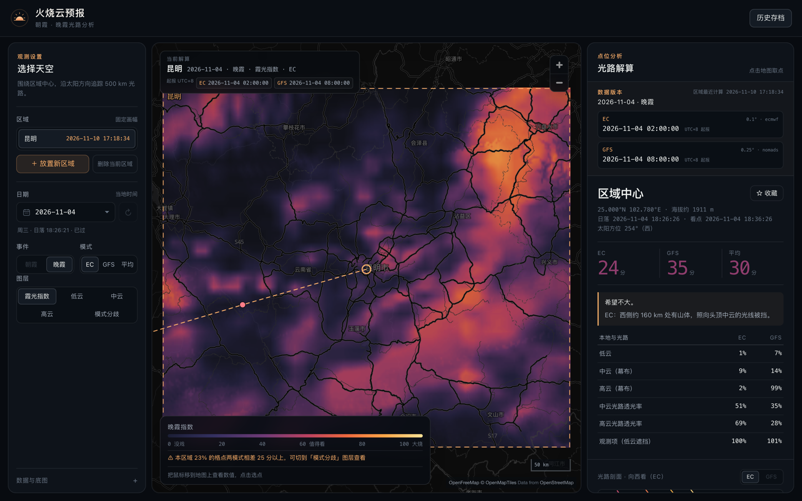

# 火烧云预报

在本机运行的朝霞 / 晚霞（火烧云）预报网页。下载 GFS 和 ECMWF 的低、中、高云量预报，沿太阳方向逐格追踪光路，估算未来几天日出、日落时每个地点霞光的浓烈程度，在地图上着色显示。



- **任选区域**：在地图上放一个固定大小的框（默认 4° × 5°），只计算框里的地方。
- **双模式对比**：EC 与 GFS 分别打分，也可以看平均值和两者的分歧。
- **点位解算**：点击地图上任意一点，显示分数、各层云量、光路透光率，告诉你是哪里的云或山挡住了光，并画出光路剖面。
- **收藏机位**：常去的地点可以收藏，在总览表里一眼看完未来几天的朝霞和晚霞。
- **历史存档**：每次计算都会留一份快照，可以回看当时的预报。

> 评分参数还没有用实拍校准，结果只能作为参考。它不是天气预报，云量预报本身也有误差；模式分歧大的地方，可信度更低。

## 原理

霞光好不好看，大致取决于三件事：

1. **头顶有没有能被染色的云（幕布项）**：中云（约 4.5 km）和高云（约 9 km）适量最好；完全没有云就没有颜色，满天厚云则偏暗。
2. **光能不能照过来（光路项）**：太阳在地平线附近时，光要横穿几百公里才能照到头顶的云。程序沿太阳方位角向外追踪 500 km，在几个太阳高度角下计算光线高度（考虑地球曲率和大气折射），被沿途云层衰减多少、有没有被山挡住。
3. **你能不能看见（观测项）**：本地低云会挡住视线；观测点海拔够高时，低云在脚下，反而可能出现云海。

三项合成 0–100 的指数。云量在两个预报时次之间插值到“日落后 10 分钟 / 日出前 10 分钟”。所有权重和阈值都在 `config/default.yaml` 的 `scoring` 下。

## 快速开始

### 环境要求

- Python 3.14（目前只在 3.14 上测试过）。依赖都有预编译 wheel（含 eccodes 和 GDAL），不需要另装系统库。
- macOS 或 Linux。Windows 建议用下面的 Docker 方式。
- 能访问 NOAA、ECMWF、AWS、unpkg 和 OpenFreeMap（见下文“网络”）。

### 一键启动（macOS / Linux）

```bash
./start.sh
```

第一次运行会创建 `.venv` 并安装依赖，然后启动服务，自动在浏览器打开 http://127.0.0.1:8765 。

### 手动启动

```bash
python3 -m venv .venv
.venv/bin/pip install -r requirements.txt
.venv/bin/python -m glow serve
```

### Docker

```bash
docker compose up -d --build
```

然后打开 http://127.0.0.1:8765 。停止用 `docker compose down`，看日志用 `docker compose logs -f glow`。容器只挂载项目里的 `data/`（运行数据）和 `config/`（配置，只读），所以本地运行和 Docker 看到的是同一份区域、收藏和结果，重建镜像也不会丢。

## 使用

启动时不会计算任何东西：

1. 点“＋ 放置新区域”，框会跟着鼠标移动，单击放到想看的地方，起个名字，点“开始计算”。
2. 第一次在新地方计算需要下载地形和云量，通常 1–3 分钟，进度显示在右上角；之后再看是秒开。
3. 历史日期只有已有记录时才可选；未来最多到 3 天后，尚未计算的日期也可以选，点日期旁的“↻”补算。刷新只覆盖所选日期。
4. 点地图上任意一点看详情。想长期关注的地点，点详情标题旁的“☆ 收藏”，它就会出现在“收藏机位总览”里；再点一次取消。
5. 每次成功计算都会存一份不可变快照。点右上角“历史存档”可以查看、单条删除或按区域清空。存档不会自动清理，删除区域也不会删掉存档。

命令行：

```bash
.venv/bin/python -m glow run                 # 重算所有已保存的区域后退出
.venv/bin/python -m glow run --region <id>   # 只算一个区域
```

`glow run` 适合放进 cron 之类的定时任务，每天自动更新。

## 配置

默认配置在 `config/default.yaml`，每一项都有中文注释。不要直接改它；把要改的键写进 `config/local.yaml`（不进 git），启动时会覆盖默认值。参考 [config/local.example.yaml](config/local.example.yaml)：

```yaml
server:
  port: 8800
map:
  start_center: [102.7, 25.0]   # 初始视野：[经度, 纬度]
  start_zoom: 6
```

嵌套的键逐层合并，列表和普通值整体替换。常改的项：

| 键 | 作用 |
| --- | --- |
| `regions.frame` | 区域框大小和网格步长 |
| `forecast.days` / `forecast.keep_days` | 往后预报几天；已算日期和云量缓存保留几天 |
| `map.style_url` | 底图样式（MapLibre 样式地址） |
| `server.host` / `server.port` | 监听地址和端口，也可以用环境变量 `GLOW_SERVER_HOST`、`GLOW_SERVER_PORT` |
| `server.allowed_hosts` | 允许修改数据的 Host 名，用局域网 IP 访问时要把它加进来 |
| `sources.*` | 数据源地址、重试次数、超时和限速 |
| `scoring.*` | 评分权重和阈值 |

也可以用 `python -m glow --config 路径 serve` 指定一份完整的配置文件，这时不会再读 `local.yaml`。

## 数据和磁盘

运行时数据都在 `data/` 下，不进 git：

| 路径 | 内容 | 大小参考 |
| --- | --- | --- |
| `data/regions.json` | 框选的区域 | 很小 |
| `data/spots.json` | 收藏的机位 | 很小 |
| `data/cache/` | 云量和地形缓存 | ECMWF 不能按区域下载，每个起报要存一份全球数据，0.1° 约 65 MB；超过 `keep_days` 的起报会在下次计算时清理，一般稳定在 200–300 MB |
| `data/output/` | 网页读取的结果和历史存档 | 每个区域约 2 MB，每份存档约 1 MB；存档只能手动删除 |

## 网络

计算时会访问以下地址（数据源地址都在 `config/default.yaml` 里，可以改）：

- 云量：`nomads.ncep.noaa.gov`、`noaa-gfs-bdp-pds.s3.amazonaws.com`、`data.ecmwf.int`；主源失败时回退到 `api.open-meteo.com`
- 地形：`copernicus-dem-90m.s3.amazonaws.com`
- 网页：`unpkg.com`（MapLibre、flatpickr，带完整性校验）和 `tiles.openfreemap.org`（底图）

需要代理时设置 `HTTPS_PROXY` 环境变量；地形通过 GDAL 下载，如果它没有走代理，再设置 `GDAL_HTTP_PROXY`。Open-Meteo 有频率限制，回退时会自动放慢请求，计算可能明显变慢。

## 安全

服务没有登录和权限控制，只适合在自己电脑上用：

- 默认只监听 `127.0.0.1`，Docker 也只把端口映射到本机。不要把它暴露到公网。
- 修改数据的请求会检查 Origin 和 Host，防止其他网页跨站操作，或通过 DNS 重绑定操作本机服务。

## 开发

```bash
.venv/bin/pip install -r requirements-dev.txt
.venv/bin/python -m pytest
```

测试不访问网络（数据源用 monkeypatch 或 `tests/data/` 下的样本）。前端是纯静态文件（`site/`），没有构建步骤。代码结构见 [AGENTS.md](AGENTS.md)。

## 许可与数据条款

代码以 [MIT 许可证](LICENSE) 发布。代码许可只覆盖本仓库的源码；程序运行时下载和显示的数据各有条款，使用时需要分别遵守：

| 数据 | 用途 | 条款 |
| --- | --- | --- |
| [NOAA GFS](https://www.nco.ncep.noaa.gov/pmb/products/gfs/) | 云量预报（主源） | 美国政府公开数据，无使用限制 |
| [ECMWF 开放数据](https://www.ecmwf.int/en/forecasts/datasets/open-data) | 云量预报（主源） | CC BY 4.0，需署名 |
| [Open-Meteo](https://open-meteo.com/) | 主源失败时的回退 | 数据 CC BY 4.0；免费 API 仅限非商业使用，商业用途需购买 API 套餐 |
| [Copernicus DEM GLO-90](https://dataspace.copernicus.eu/explore-data/data-collections/copernicus-contributing-missions/collections-description/COP-DEM) | 地形遮挡和观测点海拔 | 免费使用，需按其许可署名 |
| [OpenFreeMap](https://openfreemap.org/) / [OpenStreetMap](https://www.openstreetmap.org/copyright) | 底图 | 需署名 OpenStreetMap 贡献者（ODbL） |

网页左下角“数据与底图”里保留了上述署名，二次分发或改造界面时请不要移除。评分参数尚未用实拍校准，结果仅供参考。
